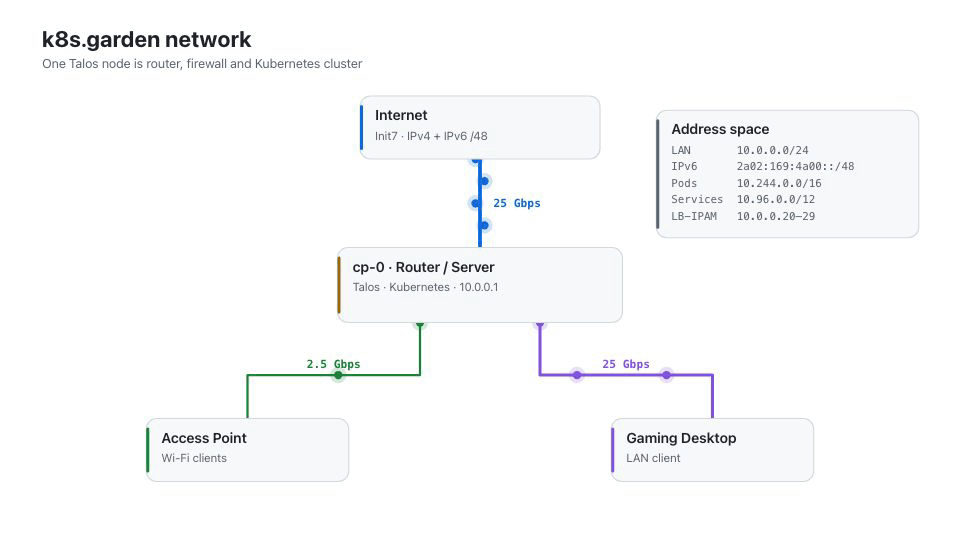
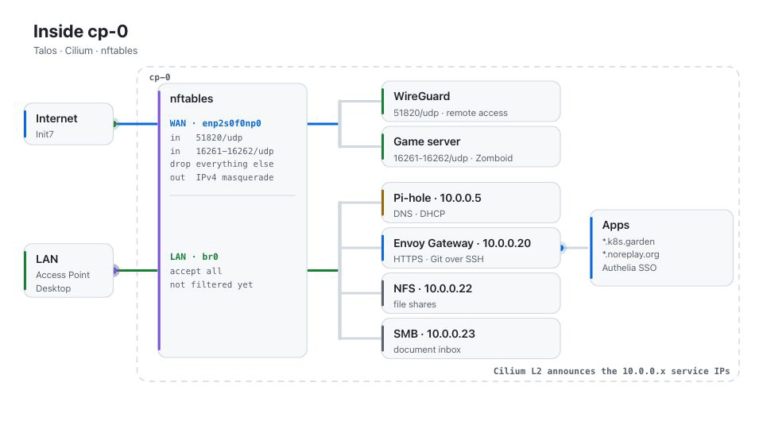
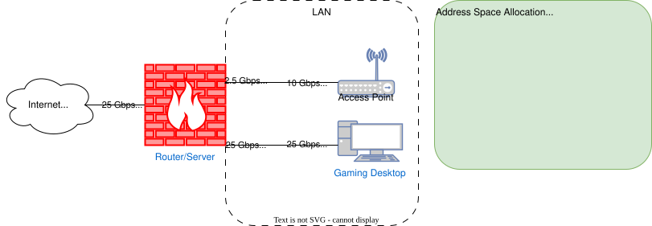

# K8s Garden Homelab Configuration
This repository contains the configuration for my homelab. It is run on [Talos](https://www.talos.dev/) and managed with [Flux](https://fluxcd.io/).

For more information check out the official documentation:
- [Talos Documentation](https://www.talos.dev/latest/)
- [Flux Documentation](https://fluxcd.io/flux/)

## Network

A single Talos node (`cp-0`) is router, firewall and Kubernetes cluster:

Physical network layout:

<picture>
  <source media="(prefers-color-scheme: dark)" srcset="./docs/network-physical-dark.gif">
  
</picture>

Logical network layout inside:

<picture>
  <source media="(prefers-color-scheme: dark)" srcset="./docs/network-inside-dark.gif">
  
</picture>

<!-- Network topology simplified:

 -->
